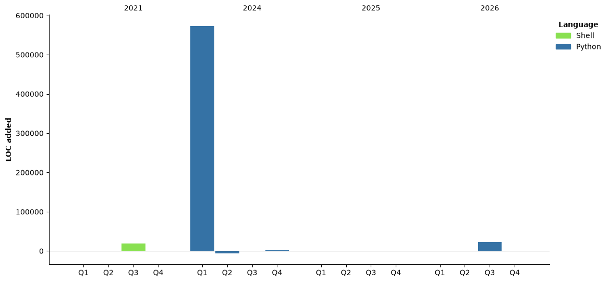

# Hi, I’m Jun

I work on inverse rendering and 4D reconstruction. I’m interested in what we can recover from images, from the roughness of a reflective surface to the motion of a scene over time.

<!--
## Selected work

**[MU-BGS](https://github.com/yejun688/MU-BGS) · Recovering shape and materials**

A shiny teapot reflects the room around it. MU-BGS combines Gaussian splatting with a signed distance field to estimate the teapot’s shape, base color, roughness, and metallic properties so it can be rendered under new lighting.

[](https://github.com/yejun688/MU-BGS)

**[QTT-4D](https://github.com/yejun688/QTT-4D) · Rendering scenes in motion**

QTT-4D represents a changing scene with quantized tensor trains and renders it from new viewpoints. The repository walks through training on the *coffee_martini* sequence and exporting RGB images, depth visualizations, and videos.
-->

## Paper lists

I organize oral papers by topic and collect links to papers, project pages, and code. Browse the [CVPR 2025 collection](https://github.com/yejun688/CVPR_2025_Oral_Paper_List) or the [ICCV 2025 collection](https://github.com/yejun688/ICCV_2025_Oral-papers).

<details>
<summary>Coding activity · updated daily</summary>

<!--START_SECTION:waka-->


**🐱 My GitHub Data** 

 > 
> 🏆 32 Contributions in the Year 2026
 > 
> 🚫 Not Opted to Hire
 > 
> 📜 11 Public Repositories 
 > 
 > 
**I'm a Night 🦉** 

```text
🌞 Morning                14 commits          ██░░░░░░░░░░░░░░░░░░░░░░░   07.61 % 
🌆 Daytime                57 commits          ████████░░░░░░░░░░░░░░░░░   30.98 % 
🌃 Evening                73 commits          ██████████░░░░░░░░░░░░░░░   39.67 % 
🌙 Night                  40 commits          █████░░░░░░░░░░░░░░░░░░░░   21.74 % 
```
📅 **I'm Most Productive on Friday** 

```text
Monday                   33 commits          ████░░░░░░░░░░░░░░░░░░░░░   17.93 % 
Tuesday                  23 commits          ███░░░░░░░░░░░░░░░░░░░░░░   12.50 % 
Wednesday                29 commits          ████░░░░░░░░░░░░░░░░░░░░░   15.76 % 
Thursday                 24 commits          ███░░░░░░░░░░░░░░░░░░░░░░   13.04 % 
Friday                   43 commits          ██████░░░░░░░░░░░░░░░░░░░   23.37 % 
Saturday                 21 commits          ███░░░░░░░░░░░░░░░░░░░░░░   11.41 % 
Sunday                   11 commits          █░░░░░░░░░░░░░░░░░░░░░░░░   05.98 % 
```


📊 **This Week I Spent My Time On** 

```text
🕑︎ Time Zone: Asia/Shanghai

💬 Programming Languages: 
TeX                      2 hrs 50 mins       ████████████████░░░░░░░░░   63.62 % 
Other                    56 mins             █████░░░░░░░░░░░░░░░░░░░░   21.19 % 
Python                   35 mins             ███░░░░░░░░░░░░░░░░░░░░░░   13.27 % 
SSH Config               2 mins              ░░░░░░░░░░░░░░░░░░░░░░░░░   00.97 % 
BibTeX                   1 min               ░░░░░░░░░░░░░░░░░░░░░░░░░   00.73 % 

🔥 Editors: 
Codex Vscode             3 hrs 29 mins       ████████████████████░░░░░   78.18 % 
VS Code                  57 mins             █████░░░░░░░░░░░░░░░░░░░░   21.35 % 
Codex Exec               1 min               ░░░░░░░░░░░░░░░░░░░░░░░░░   00.47 % 

🐱‍💻 Projects: 
rekkles                  3 hrs 31 mins       ████████████████████░░░░░   78.81 % 
MASK                     55 mins             █████░░░░░░░░░░░░░░░░░░░░   20.72 % 
motion-scale             1 min               ░░░░░░░░░░░░░░░░░░░░░░░░░   00.47 % 

💻 Operating System: 
Mac                      4 hrs 26 mins       █████████████████████████   99.53 % 
Linux                    1 min               ░░░░░░░░░░░░░░░░░░░░░░░░░   00.47 % 
```

🤖 **AI Coding This Week** 

```text
⏱ AI Coding Time: 4 hrs 26 mins (99.5%)

✍️ 1,505 lines written by AI, 0 lines written by hand (100.0% AI-written)

🔤 2,233,592 Input Tokens, 232,475 Output Tokens

💵 $120.43 Estimated AI Cost This Week

🧠 12 AI Sessions, 51 AI Prompts

GPT                      1,744 lines         █████████████████████████   100.00 % 

🔎 AI Coding Insights:
🤖 AI-Driven — 100.0% of written lines came from AI
📄 Detailed Prompter — average 521 characters per prompt
🔁 Iterative Prompter — average 4 prompts per session
🚀 High AI Trust — 0.0% of changed lines were hand-edited
```

**I Mostly Code in Python** 

```text
Python                   15 repos            ███████████████████████░░   93.75 % 
Shell                    1 repo              ██░░░░░░░░░░░░░░░░░░░░░░░   06.25 % 
```


**Timeline**




 Last Updated on 28/11/2026 01:33:53 UTC
<!--END_SECTION:waka-->

</details>
